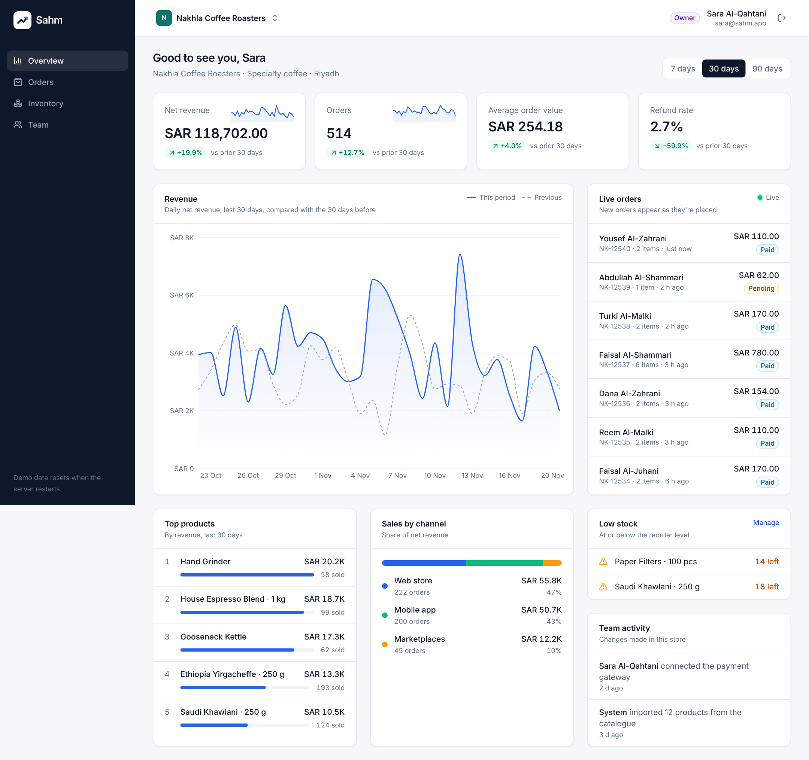
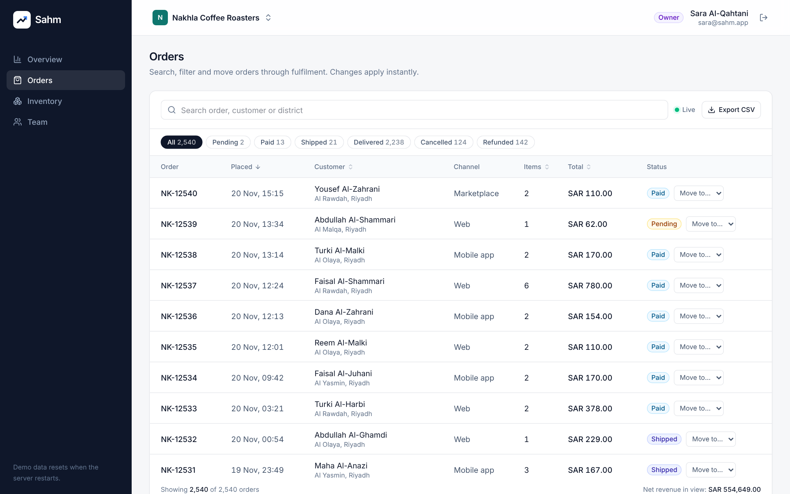
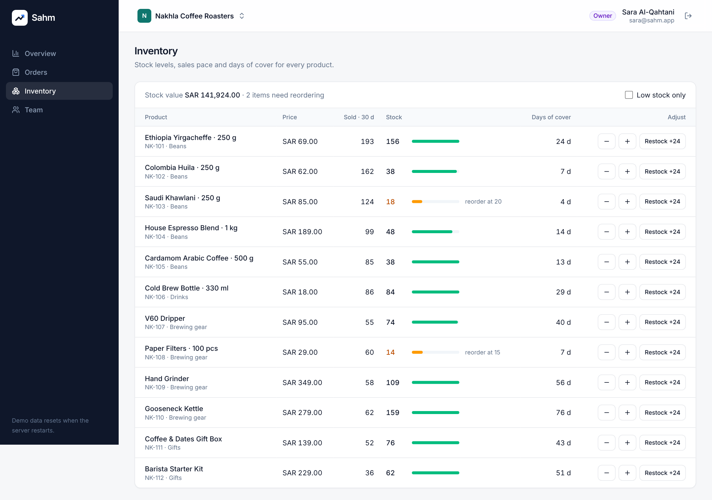
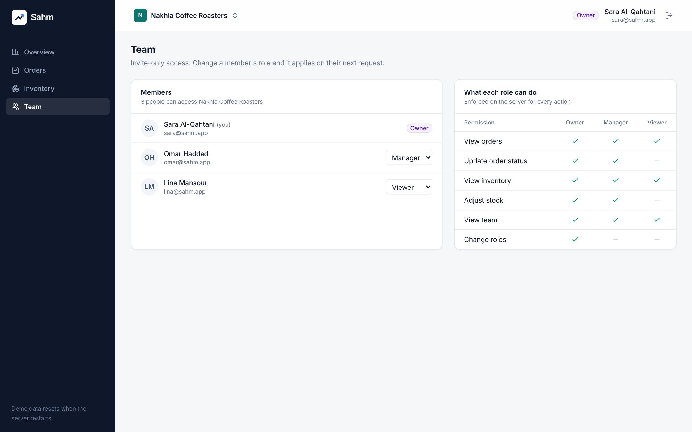
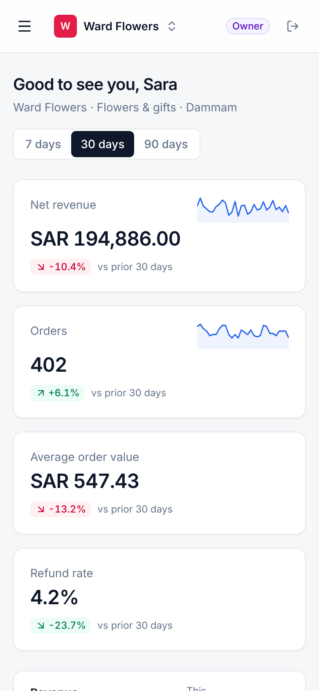

# Sahm — multi-tenant commerce analytics

[](https://github.com/Mohsen-Hussen/sahm/actions/workflows/ci.yml)


**Sahm** (سهم, "arrow") is a real-time analytics dashboard for online stores. One deployment serves many
stores, every user has a role per store, and new orders stream in live while you watch.

**Live demo:** _coming soon_ · sign in with any demo account below (password `demo1234`).

| Account         | Access                                                |
| --------------- | ----------------------------------------------------- |
| `sara@sahm.app` | Owner of all three stores, so she can manage the team |
| `omar@sahm.app` | Manager at Nakhla, viewer at Souq Tech                |
| `lina@sahm.app` | Viewer at Nakhla (read-only)                          |



<table>
  <tr>
    <td></td>
    <td></td>
  </tr>
  <tr>
    <td></td>
    <td align="center"></td>
  </tr>
</table>

## What it shows off

| Area                  | How it's done                                                                                                                                                                                        |
| --------------------- | ---------------------------------------------------------------------------------------------------------------------------------------------------------------------------------------------------- |
| **Streaming UI**      | Each dashboard section is an async Server Component behind its own `<Suspense>` boundary, so KPIs, the chart and the tables render as soon as their own query finishes.                              |
| **Real time**         | A Route Handler streams Server-Sent Events. New orders slide into the live feed, and other users' status changes show up in your table without a reload.                                             |
| **Optimistic writes** | Order status, stock and role changes use Server Actions with `useOptimistic`. The UI updates instantly and rolls back with a toast if the server rejects the change.                                 |
| **Multi-tenancy**     | Routes live under `/s/[store]`, and `proxy.ts` can map `nakhla.your-domain.com` to the same pages. Every query takes an explicit `storeId`, and a test proves one store can't touch another's data.  |
| **Auth & RBAC**       | Signed, `httpOnly` JWT session cookie (`jose`) and PBKDF2 password hashing. One permission matrix drives the UI and is checked again in every Server Action. Non-members get a 404, not a 403.       |
| **Big tables**        | TanStack Table plus TanStack Virtual render about 2,500 orders smoothly, with search, status filters, sorting and CSV export that is safe against formula injection.                                 |
| **Data layer**        | Drizzle ORM on Postgres. With no `DATABASE_URL` set, it boots an in-memory **PGlite** (Postgres compiled to WebAssembly) and seeds 180 days of deterministic data, so the demo needs no setup.       |
| **Domain rules**      | Orders can only move forward (pending → paid → shipped → delivered). Stock can't go negative, and a store always keeps at least one owner. All of these rules run on the server inside transactions. |
| **Quality**           | Strict TypeScript, ESLint, Prettier, 19 Vitest tests (unit and real-database integration) and 8 Playwright end-to-end flows, all run in CI on every push.                                            |

## Architecture

```
src/
├─ app/
│  ├─ login/                 sign-in page + Server Actions
│  ├─ s/[store]/             tenant-scoped dashboard (overview, orders, inventory, team)
│  │  └─ actions.ts          Server Actions → authorize() → mutation → revalidate + publish
│  └─ api/stores/[store]/live/route.ts   Server-Sent Events stream
├─ server/
│  ├─ auth.ts                Data Access Layer: session → user → store membership → role
│  ├─ queries.ts             read models (KPIs, series, top products …), all scoped by storeId
│  ├─ mutations.ts           transactional writes with domain rules
│  └─ live.ts                in-process pub/sub + demo order simulator
├─ db/                       Drizzle schema, client (PGlite or Postgres), deterministic seed
├─ lib/                      permissions, money, CSV, tenant parsing, password hashing
├─ components/               UI, overview sections, tables, live feed
└─ proxy.ts                  subdomain → /s/[store] rewrite + optimistic auth gate
```

A status change, end to end:

1. The table applies the new status optimistically and calls the `setOrderStatus` Server Action.
2. `authorize(slug, "orders:update")` checks the session, the store membership and the role.
3. `updateOrderStatus` locks the row, validates the transition and writes the change plus an activity entry in one transaction.
4. `revalidatePath` refreshes the server-rendered data, and `publish()` pushes the change to everyone else watching that store.

## Getting started

```bash
nvm use            # Node 22
npm install
npm run dev        # http://localhost:3000
```

No database or `.env` is needed for local development. Copy `.env.example` to configure:

| Variable          | Purpose                                                                                    |
| ----------------- | ------------------------------------------------------------------------------------------ |
| `SESSION_SECRET`  | **Required in production.** Signs the session cookie (`openssl rand -base64 32`).          |
| `DATABASE_URL`    | Optional Postgres URL (Neon, Supabase, RDS…). Tables are created and seeded on first boot. |
| `ROOT_DOMAIN`     | Optional. Enables subdomain routing, e.g. `nakhla.example.com`.                            |
| `LIVE_SIMULATION` | Set to `off` to stop the demo order generator.                                             |

## Scripts

| Command             | What it does                                  |
| ------------------- | --------------------------------------------- |
| `npm run dev`       | Start the dev server                          |
| `npm run build`     | Production build                              |
| `npm test`          | Vitest unit + database integration tests      |
| `npm run test:e2e`  | Playwright end-to-end tests (builds required) |
| `npm run lint`      | ESLint                                        |
| `npm run typecheck` | Route type generation + `tsc --noEmit`        |
| `npm run format`    | Prettier                                      |

## Deploying

The app runs on any Node.js host. On Vercel, import the repository and set `SESSION_SECRET`.

> **About the demo database:** without `DATABASE_URL`, each server instance keeps its own in-memory copy of
> the data, so changes reset when the instance restarts. Set `DATABASE_URL` to share data between
> instances. To run several instances against one database, replace the in-process pub/sub in
> `src/server/live.ts` with Postgres `LISTEN/NOTIFY` or Redis.

## License

MIT © Mohsen Hussein
